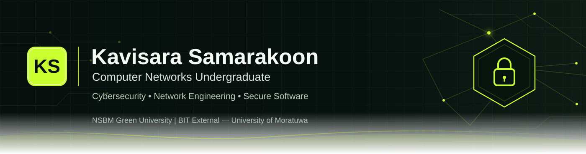
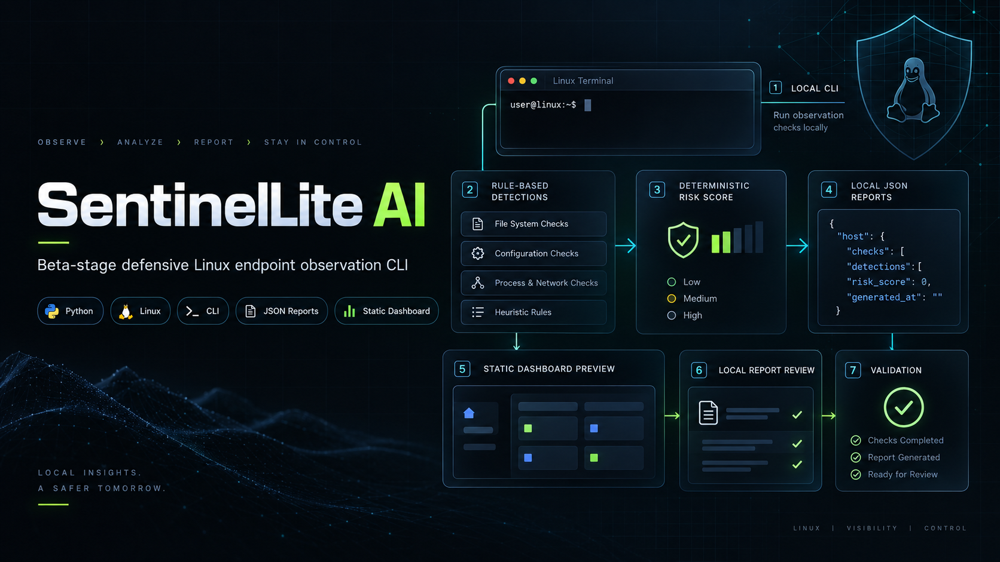
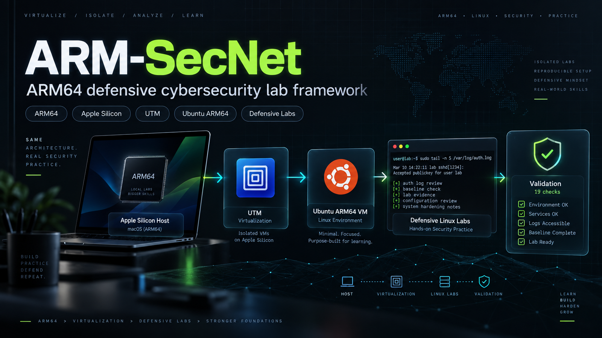
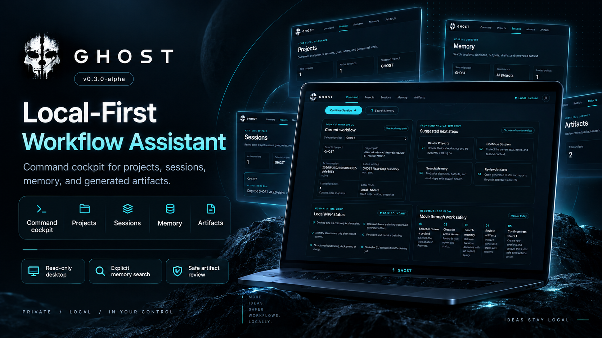

<!-- GitHub Profile README — Kavisara Samarakoon -->

  <!-- Animated Cybersecurity Header -->
  

  
  <h1>Hi, I'm Kavisara Samarakoon 👋</h1>

  

    <b>Computer Networks Student</b> ·
    <b>Cybersecurity & Network Engineering Focus</b> ·
    <b>Secure Full-Stack Development</b>
  

  <!-- Animated Technical Focus -->
  

    
  

  <!-- Professional Links -->
  

    
    
    
  

---

## 👨‍💻 About Me

I am a **BSc (Hons) Computer Networks undergraduate at NSBM Green University**, Sri Lanka, and a **BIT External undergraduate at the University of Moratuwa**.

My main career direction is **Cybersecurity Analysis and Network Engineering**. I learn through practical labs, real configurations, technical documentation, defensive security tooling, and secure software projects.

My work connects **networking, cybersecurity, Linux systems, ARM64 labs, local-first workflows, and software development** through practical project-based learning.

---

## 🎯 Current Focus

- Developing **SentinelLite AI**, a beta-stage defensive Linux endpoint observation and report-review CLI
- Building **ARM-SecNet**, an ARM64-first defensive cybersecurity lab framework for Apple Silicon
- Developing **GHOST**, a local-first workflow assistant for project context, sessions, handoffs, and artifacts
- Continuing **NEXORA**, a private full-stack game deals and giveaway discovery MVP
- Improving **Linux security, endpoint observation, file integrity, rule-based detection, dashboards, and lab validation**
- Strengthening **Python, Rust, Tauri, React, TypeScript, Next.js, Spring Boot, GitHub Actions, and CI/CD**
- Preparing for a career as a **Cybersecurity Analyst and Network Engineer**

<!-- Minimal animated cybersecurity section divider -->

  

# 🚀 Featured Work

## 🛡️ SentinelLite AI

**SentinelLite AI** is a beta-stage defensive Linux CLI for local endpoint observation, rule-based analysis, JSON alert reporting, report review, and static security dashboard generation.

  

**Tools:** Python · Linux · JSON Reports · GitHub Actions

  
  

<b>🖼️ Project preview</b>

  

<b>🔎 Release, validation & technical details</b>

 

It collects selected host facts when a command is run, applies transparent rules, assigns deterministic risk scores, writes local JSON alert reports, and presents rule-based investigation guidance.

**Current release:** [`v1.2.0-beta`](https://github.com/kavisara-samarakoon/sentinellite-ai/releases/tag/v1.2.0-beta)

**Validation:**

- 652 tests passed
- Ruff passed
- `pip check` passed
- Dashboard export works
- Python 3.11 and Python 3.14 CI validation completed

**Focus:**

Python · Linux Security · Endpoint Observation · Auth Logs · File Integrity · Rule-Based Detection · Risk Scoring · JSON Reports · Static Dashboard · GitHub Actions

### Safety boundaries

SentinelLite AI is a **local/on-demand defensive learning tool**.

It is not:

- a production EDR
- antivirus
- malware removal software
- a SIEM/SOC platform
- an enterprise security platform
- a live monitoring daemon
- a public scanner
- an exploit tool
- an automatic remediation system
- a real AI/LLM-powered security agent

---

## 🧪 ARM-SecNet

**ARM-SecNet** is a public ARM64-first defensive cybersecurity lab framework for Apple Silicon users, combining UTM-based Linux labs, defensive exercises, screenshot-backed evidence, and validation workflows.

  

**Tools:** Apple Silicon · UTM · Ubuntu ARM64 · Bash · GitHub Actions

  
  

<b>🖼️ Project preview</b>

  

<b>🔎 Labs, validation & technical details</b>

 

ARM-SecNet is designed for students, lecturers, and security learners who want reproducible ARM64 Linux security labs using an Apple Silicon Mac, UTM virtualization, Ubuntu ARM64, defensive exercises, and validation checks.

**Current release:**

[`v1.1.0-sentinellite-dashboard-lab`](https://github.com/kavisara-samarakoon/arm-secnet/releases/tag/v1.1.0-sentinellite-dashboard-lab)

**Current labs:**

- Linux Baseline Investigation
- Authentication Log Analysis
- SentinelLite AI Local CLI and Static Dashboard

**Validation:**

- 29 passed
- 0 warnings
- 0 failures
- GitHub Actions validation CI added and passed

**Focus:**

ARM64 · Apple Silicon · UTM · Ubuntu ARM64 · Defensive Linux Labs · Screenshot Evidence · Lab Validation · GitHub Actions

### Validation limitation

Existing Lab 03 evidence was recorded on **one Ubuntu 26.04 LTS aarch64 VM** using a specific SentinelLite source commit.

The existing evidence does **not** validate the exact SentinelLite `v1.2.0-beta` wheel. Exact-release VM validation should be recorded separately in a future release or lab update.

### Safety boundaries

ARM-SecNet is a defensive education and lab framework.

It is not:

- a production EDR
- antivirus
- a SIEM/SOC platform
- malware removal software
- an offensive toolkit
- a public scanner
- an automatic remediation system
- universal ARM64 compatibility proof

---

## 👻 GHOST

**GHOST** — **GitHub, Handoff, Operations, Search, and Tracking** — is a local-first workflow assistant built with **Tauri, React, Rust, and Python** for managing project context, sessions, handoffs, and artifacts through reviewed, explicitly controlled workflows.

  

**Tools:** Tauri 2 · Rust · React · TypeScript · Python

  
  

<b>🖼️ Project preview</b>

  

<b>🔎 Current capabilities, status & safety boundaries</b>

 

The published `v0.5.0-alpha` checkpoint provides a local-first Python CLI and macOS desktop companion with:

- macOS Command Space cockpit
- Projects page
- Sessions page
- Memory page
- Artifacts page
- Local project/session snapshot review
- Explicit-submit local memory search
- Safe Open / Reveal actions for approved artifacts
- Python CLI workflow engine
- Project registry
- Session manager
- Output logging
- Deterministic next-step drafts
- Context pack generation
- Handoff draft generation for Codex, ChatGPT, Gemini, and Antigravity
- Update pack generation
- Doctor / validation checks
- GitHub Actions CI validation
- Reviewed Action Requests and explicit CLI confirmation before allowlisted actions
- Controlled advisory AI review and finite local orchestration with fresh approval
- Opt-in voice transcription and proposal-only intent interpretation

**Current public pre-release:**

[`v0.5.0-alpha`](https://github.com/kavisara-samarakoon/ghost/releases/tag/v0.5.0-alpha)

**Status:**

Public alpha for controlled testing. The published Apple Silicon desktop build is not Developer ID signed/notarized, and live-provider end-to-end validation remains a separate requirement. The preview image above shows an older interface checkpoint.

**Focus:**

Tauri · React · TypeScript · Rust · Python · Local-First Workflow · Project Context · Handoffs · Artifacts · GitHub Actions

### Safety boundaries

The desktop app does **not**:

- invoke the Python CLI or run arbitrary shell commands
- execute pending Action Requests or intent plan drafts directly
- automatically push, merge, tag, publish, deploy, or release projects
- grant AI-generated suggestions workflow execution authority

AI review, voice transcription, and intent services require explicit user approval before sending selected content to an external provider.

The CLI's bounded execution paths require fresh confirmation. GHOST remains an **alpha project**, not an autonomous production agent.

---

## 🌐 Personal Portfolio Website

A modern responsive portfolio presenting my background, skills, projects, and career direction across cybersecurity, networking, systems, and full-stack development.

It includes full project pages for **SentinelLite AI, ARM-SecNet, GHOST, NEXORA, networking/security labs, academic projects, and personal technical work**.

**Focus:** Frontend Development · UI/UX · Personal Branding · Responsive Design · Project Documentation

  

---

## 🎮 NEXORA

**NEXORA** is a private full-stack game deals and giveaway discovery MVP with dashboard UI, backend API foundations, authentication flow, wishlist features, alert concepts, documentation, and CI/CD workflow usage.

  

<b>🔎 Project direction & technical focus</b>

 

NEXORA is designed as a secure, network-aware game deals intelligence platform concept, with future direction toward wishlist price alerts, game discovery, and assistant-supported deal monitoring.

**Status:** Private technical MVP

**Focus:**

Next.js · Spring Boot · PostgreSQL · REST API · Auth Foundation · Wishlist · Alerts · CI/CD · Product Documentation

<!-- Minimal circuit transition between projects and technical stack -->

  

# 🛠️ Technical Stack

<b>🛡️ Defensive Security, Networking & Labs</b>

 

  
  
  
  
  
  
  
  
  
  
  
  

<b>💻 Languages, Frameworks & Databases</b>

 

  

  
  
  
  

<b>⚙️ Tools, Desktop & Workflow</b>

 

  

  
  
  
  
  

---

# 📚 More About My Work

  

<b>📌 Project Highlights</b>

 

| Area | What I’m building |
|---|---|
| **Defensive Security Tooling** | SentinelLite AI beta-stage local CLI, Linux endpoint observation, rule-based detection, deterministic risk scoring, JSON alert reports, and static dashboard export |
| **ARM64 Defensive Labs** | ARM-SecNet using Apple Silicon, UTM, Ubuntu ARM64, screenshot-backed evidence, and validation workflows |
| **Local-First Workflow Systems** | GHOST alpha desktop/CLI for project context, sessions, memory search, handoffs, artifacts, reviewed requests, and approval-gated workflows |
| **Network Security Labs** | pfSense firewalling, Snort IDS/IPS, NAT, VPN concepts, controlled testing, and network security documentation |
| **VoIP Systems** | FreeBSD + Asterisk PBX, SIP/PJSIP, SIP-TLS, ZRTP, voicemail, IVR, and controlled VoIP lab testing |
| **Full-Stack Projects** | NEXORA private technical MVP, personal portfolio, Next.js frontend work, Spring Boot backend foundations, REST APIs, and authentication concepts |
| **Documentation & Validation** | GitHub README files, lab reports, release notes, screenshot evidence, validation scripts, GitHub Actions, and reviewer-friendly project structure |

<b>📚 Currently Learning</b>

 

- Advanced computer networking concepts
- Network security and firewall rule design
- Linux system administration and security
- Defensive endpoint observation
- File integrity monitoring and baseline comparison
- Rule-based detection, risk scoring, and JSON report design
- ARM64 Linux lab validation using Apple Silicon and UTM
- Local-first desktop workflow development with Tauri, Rust, React, and Python
- Secure web application development with Next.js and Spring Boot
- CI/CD, GitHub Actions, release assets, and technical documentation
- Cloud and infrastructure fundamentals

<b>📊 GitHub Activity</b>

 

I use GitHub to document practical labs, build full-stack projects, track development milestones, publish release checkpoints, and improve my technical portfolio step by step.

My focus is not only writing code, but also maintaining **clear documentation, clean repositories, validation evidence, release notes, and reviewer-friendly project structure**.

<b>🧭 Career Direction</b>

 

I am working toward becoming a **Cybersecurity Analyst and Network Engineer**.

My goal is to build a strong technical foundation through:

- practical networking labs
- secure system design
- defensive cybersecurity learning
- local security tooling
- ARM64 defensive lab validation
- local-first workflow tooling
- full-stack development projects
- technical documentation
- continuous hands-on practice

---

<h1 align="center">📫 Connect With Me</h1>

  
  
  
  

---

  <b>Cybersecurity · Network Engineering · Defensive Linux Tooling · ARM64 Labs · Secure Software</b>

<!-- Animated Cybersecurity Footer -->

  

