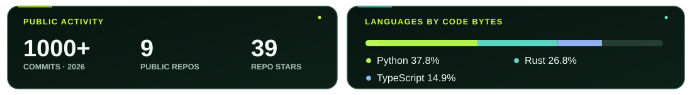

<!-- GitHub Profile README — Kavisara Samarakoon -->

  <!-- Animated Cybersecurity Header -->
  

  
  <h1>Hi, I'm Kavisara Samarakoon 👋</h1>

  

    <b>Computer Networks Student</b> ·
    <b>Cybersecurity & Network Engineering Focus</b> ·
    <b>Secure Full-Stack Development</b>
  

  <!-- Animated Technical Focus -->
  

    
  

  <!-- Professional Links -->
  

    
    
    
  

---

## 👨‍💻 About Me

I am a **BSc (Hons) Computer Networks undergraduate at NSBM Green University** and a **BIT External undergraduate at the University of Moratuwa**.

I focus on **defensive cybersecurity, network engineering, Linux systems, ARM64 labs, and secure software**, learning through practical projects and technical documentation.

---

## 🎯 Current Focus

- **SentinelLite AI:** Defensive Linux endpoint observation and rule-based security reporting.
- **ARM-SecNet:** Practical ARM64 security labs, networking, and validation.
- **GHOST:** Local-first workflow tooling built with Rust, Tauri, React, and Python.

<!-- Minimal animated cybersecurity section divider -->

  

# 🚀 Featured Work

## 🛡️ SentinelLite AI

A beta-stage, on-demand Linux security CLI for endpoint observation, rule-based checks, JSON alerts, and static dashboards.

  

**Tools:** Python · Linux · JSON Reports · GitHub Actions

  
  

<b>🖼️ Project preview</b>

  

<b>🔎 Validation & scope</b>

- Published pre-release: **v1.2.0-beta**.
- Reported validation: **652 tests passed**, Ruff, `pip check`, and Python 3.11/3.14 CI.
- Defensive local learning tool; **not a production EDR, SIEM, or autonomous AI agent**.

Full implementation details and limitations are in the [project repository](https://github.com/kavisara-samarakoon/sentinellite-ai).

---

## 🧪 ARM-SecNet

An ARM64-first defensive cybersecurity lab framework using Apple Silicon, UTM, Ubuntu ARM64, and reproducible validation evidence.

  

**Tools:** Apple Silicon · UTM · Ubuntu ARM64 · Bash · GitHub Actions

  
  

<b>🖼️ Project preview</b>

  

<b>🔎 Labs & validation</b>

- Labs cover Linux baselines, authentication logs, and SentinelLite AI's local CLI/dashboard.
- Published release: **v1.1.0-sentinellite-dashboard-lab**; reported validation: **29 passed, 0 failures**.
- Lab 03 evidence comes from one Ubuntu ARM64 VM and does **not** verify the exact SentinelLite v1.2.0-beta wheel.

Further lab evidence and safety boundaries are in the [project repository](https://github.com/kavisara-samarakoon/arm-secnet).

---

## 👻 GHOST

A local-first macOS workflow assistant for managing projects, sessions, memory, handoffs, and artifacts through explicit approval-based workflows.

  

**Tools:** Tauri 2 · Rust · React · TypeScript · Python

  
  

<b>🖼️ Project preview</b>

  

<b>🔎 Alpha capabilities & limitations</b>

- Published pre-release: **v0.5.0-alpha**, with a Tauri desktop companion and Python CLI.
- Includes project/session review, local memory search, context and handoff packs, and controlled action requests.
- Experimental **public alpha**, not an autonomous production agent; external-provider use and bounded actions require explicit approval. The desktop build is not Developer ID signed/notarized.

See [GHOST's repository](https://github.com/kavisara-samarakoon/ghost) for full capabilities and safety boundaries.

---

## 🌐 Other Projects

**[Personal Portfolio](https://kavisara-samarakoon-portfolio.vercel.app/)** — Responsive web portfolio showcasing cybersecurity, networking, and software development work.

**NEXORA** — Private Next.js and Spring Boot game deals/giveaway discovery MVP, still in development.

<!-- Minimal circuit transition between projects and technical stack -->

  

# 🛠️ Technical Stack

<b>🛡️ Defensive Security, Networking & Labs</b>

 

  
  
  
  
  
  
  
  
  
  
  
  

<b>💻 Languages, Frameworks & Databases</b>

 

  

  
  
  
  

<b>⚙️ Tools, Desktop & Workflow</b>

 

  

  
  
  
  
  

<!-- Live public GitHub metrics (daily GitHub Actions refresh) -->

  <picture>
    <source media="(prefers-color-scheme: dark)" srcset="./assets/banner/github-live-metrics-dark.svg" />
    <source media="(prefers-color-scheme: light)" srcset="./assets/banner/github-live-metrics-light.svg" />
    
  </picture>

---

<h1 align="center">📫 Connect With Me</h1>

  
  
  
  

---

  <b>Cybersecurity · Network Engineering · Defensive Linux Tooling · ARM64 Labs · Secure Software</b>

<!-- Animated Cybersecurity Footer -->

  

